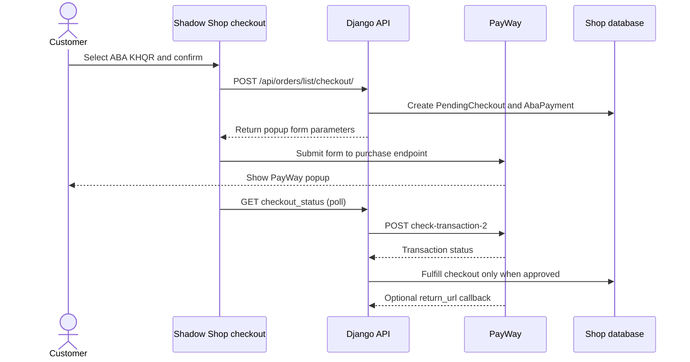
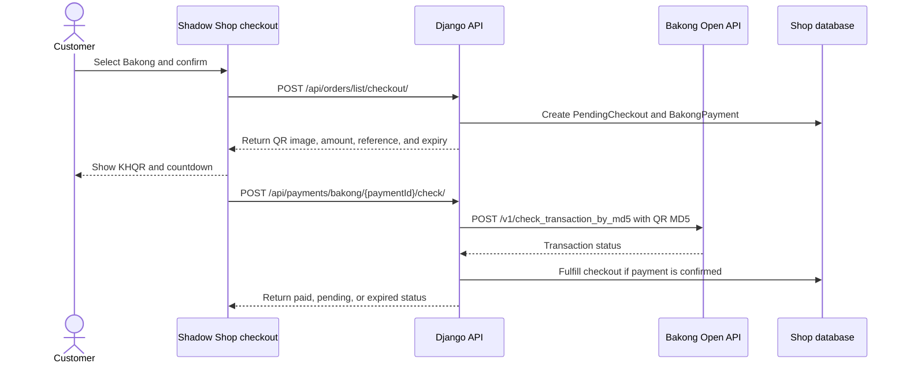

# ABA PayWay and Bakong KHQR Integration

**Project:** Shadow Shop  
**Reviewed:** 29 October 2026  
**Payment methods:** PayWay eCommerce popup with ABA KHQR; dynamic Bakong KHQR

## Overview

Shadow Shop supports two online QR payment flows: ABA PayWay eCommerce checkout and a dynamic KHQR generated by the shop for Bakong. Both create a pending checkout first. The order is fulfilled only after the backend confirms payment with the relevant provider.

The ABA popup and both providers' server-side status checks are implemented. The ABA lifetime, polling interval, callback signature enforcement, and local callback URL still need attention before treating that flow as production-ready. Bakong-specific configuration and review notes are below.

## ABA PayWay payment flow

## Current ABA PayWay implementation

1. `frontend/src/pages/customer/Checkout.jsx` submits the checkout to the shop API.
2. `backend/apps/orders/views.py` routes online payments to `prepare_online_checkout`.
3. `backend/apps/payments/checkout_flow.py` creates a `PendingCheckout` with an expiry timestamp and calls the ABA parameter builder.
4. `backend/apps/payments/aba_services.py` creates the PayWay purchase fields, including `payment_option=abapay_khqr` and `view_type=popup`.
5. The frontend creates a POST form with `target="aba_webservice"`, loads PayWay's checkout script, and calls `AbaPayway.checkout()`.
6. The frontend checks the shop's `checkout_status` endpoint. The backend calls PayWay's `check-transaction-2` endpoint and fulfills the pending checkout only when the result indicates an approved payment.
7. PayWay can also POST to `/api/payments/aba/callback/` using the `return_url` in the purchase request.

## Configuration

Set these values in the backend environment. Keep the API key on the server and never put it in frontend code or commit it to Git.

| Variable | Purpose |
| --- | --- |
| `ABA_PAYWAY_MERCHANT_ID` | Merchant ID for the selected PayWay environment |
| `ABA_PAYWAY_API_KEY` | Server-side key used to sign PayWay requests and verify callbacks |
| `ABA_PAYWAY_IS_SANDBOX` | `True` for sandbox; `False` for production |
| `BACKEND_URL` | Public base URL used to construct the PayWay callback URL |
| `FRONTEND_URL` | Website URL used for the post-checkout success and cancel URLs |
| `BAKONG_EXPIRATION_MINUTES` | Shared pending-checkout and Bakong QR lifetime; the ABA request currently sends an empty PayWay `lifetime` |

The local environment inspected on 29 October 2026 has sandbox mode enabled, a five-minute pending-checkout setting, and `BACKEND_URL` set to localhost. PayWay cannot call a localhost callback from its servers. For local callback testing, use a secured public development tunnel; for deployment, set `BACKEND_URL` to the public API origin.

The current callback URL is built from `BACKEND_URL` as `/api/payments/aba/callback/` and base64-encoded for the PayWay request. If that URL's main domain differs from the website domain used to start checkout, whitelist the callback domain in the PayWay merchant profile.

## ABA PayWay review findings to resolve

### 1. Send and enforce a transaction lifetime

The PayWay request currently sends an empty `lifetime` field. A five-minute expiry is recorded on the local pending checkout, but the ABA status flow does not enforce that expiry or mark an unpaid ABA checkout expired. The local timestamp alone does not set PayWay's transaction lifetime.

Set a PayWay lifetime that matches the intended 5–15-minute window, include it in the request hash, and make the backend stop checking and expire the pending checkout when that time is reached. The existing hash field list already includes `lifetime`.

### 2. Slow down status polling and prevent overlapping requests

The checkout currently checks immediately and repeats every 1.2 seconds. The success page also polls every 1.5 seconds. Each checkout-status request triggers a PayWay Check Transaction request, which has a four-second network timeout. Slow responses can therefore overlap.

Follow the merchant's suggested schedule: wait about three seconds after checkout starts, then check every 3–5 seconds. Allow only one status request in flight. Stop after approval or when the configured lifetime expires.

### 3. Require a valid callback signature

The callback view currently verifies the `X-Payway-Hmac-Sha512` header only when a header is present. If the header is missing, it still processes the callback. Require the header and reject both missing and invalid signatures before calling the payment handler. Consider also checking the callback amount and currency against the stored payment before fulfillment.

### 4. Use a reachable callback URL and verify whitelisting

The current local `BACKEND_URL` is not reachable from PayWay. In production, use a publicly reachable HTTPS API URL and confirm the callback domain is whitelisted in the merchant profile whenever its main domain differs from the checkout website's domain.

### 5. Use PayWay's supported sandbox payer procedure

Sandbox checkout and production checkout are separate environments. A real ABA Mobile app may report `Transaction not found` when scanning a sandbox transaction. Use the test payer procedure or account provided by ABA/PayWay, and verify the result in the sandbox merchant portal. Do not treat QR creation or a browser return as proof of payment.

## Bakong KHQR integration

Bakong uses a separate dynamic KHQR flow; it does not use the PayWay popup or PayWay credentials. The backend builds the QR payload, renders a QR image, stores its MD5, and checks that MD5 against Bakong's transaction-status API.

### QR creation and status checks

1. The shared checkout endpoint creates a `PendingCheckout` with the amount and expiry timestamp.
2. `backend/apps/payments/services.py` builds a dynamic KHQR payload with the Bakong account ID, currency, amount, merchant name and city, unique checkout reference, and expiry. It calculates the QR CRC, creates a PNG QR image, and stores the MD5 of the complete QR payload.
3. The frontend displays the QR, amount, reference, and remaining time in the checkout popup.
4. The frontend calls the authenticated Bakong check endpoint. The backend sends the stored MD5 to Bakong using the configured API token, then interprets the provider response.
5. A confirmed payment marks the payment paid and fulfills the pending checkout, creating the paid order once. An unpaid response after expiry marks the payment and pending checkout expired.

The standard status endpoint used by the application is `POST /api/payments/bakong/{paymentId}/check/`. When `BAKONG_CHECK_API_URL` is set, the service instead calls that configured URL with the MD5 as a query parameter. Otherwise, it selects the National Bank of Cambodia SIT or production API endpoint based on `BAKONG_IS_TEST`.

The QR and status implementation is in `backend/apps/payments/services.py`. The authenticated check action is in `backend/apps/payments/views.py`; the customer QR popup and polling are in `frontend/src/pages/customer/Checkout.jsx`, with post-checkout status handling in `frontend/src/pages/customer/OrderSuccess.jsx`.

### Bakong configuration

| Variable | Purpose |
| --- | --- |
| `BAKONG_ACCOUNT_ID` | Merchant Bakong account or KHQR account ID used in the generated payload |
| `BAKONG_TOKEN` | Server-side bearer token for Bakong's Open API |
| `BAKONG_IS_TEST` | `True` selects the SIT status endpoint; `False` selects production |
| `BAKONG_CURRENCY` | `USD` or `KHR`; invalid values fall back to `USD` in the service |
| `BAKONG_MERCHANT_NAME` | Merchant name embedded in the KHQR payload |
| `BAKONG_MERCHANT_CITY` | Merchant city embedded in the KHQR payload |
| `BAKONG_EXPIRATION_MINUTES` | Dynamic QR and pending-checkout lifetime |
| `BAKONG_CHECK_API_URL` | Optional status-check service override; when blank, the app calls the NBC endpoint directly |
| `BAKONG_CHECK_TIMEOUT_SECONDS` | Timeout for Bakong status requests |

The local environment inspected on 29 October 2026 has `BAKONG_IS_TEST=False`, `BAKONG_CURRENCY=USD`, and a five-minute expiry. The Bakong token and account ID are configured, but their values are intentionally not included here. Because test mode is false, status checks use the production Bakong endpoint. Confirm that this is intended before testing; use a matching SIT account and token with test mode enabled for sandbox work. Never commit the token or put it in frontend code.

### Expiry and polling behavior

The current five-minute expiry is included in the dynamic QR and stored on the payment. The National Bank of Cambodia's QR integration guide says dynamic QR expiry should not exceed ten minutes. It also describes checking transaction status by the QR's MD5 until success or failure, and timing out a not-found transaction after the QR expires.

The checkout currently checks Bakong every 1.2 seconds and prevents overlapping checks with an in-flight guard. The success page refreshes payment status every 1.5 seconds. The QR expiry check is performed by the backend status service; if a check returns unpaid after expiry, the payment and pending checkout are marked expired. If the provider request errors, the payment remains pending so a temporary network failure does not count as a failed payment.

### Bakong review note

The current paid-status helper interprets successful response markers, but it does not compare the returned transaction amount, currency, or receiving account with the stored payment. Before production use, validate those response fields against the pending payment before marking it paid. The NBC Open API response includes transaction amount, currency, and receiving account details.

### Bakong verification checklist

- [ ] Confirm the merchant account ID, currency, and account details with the Bakong provider.
- [ ] For testing, use `BAKONG_IS_TEST=True` with credentials and an account intended for the SIT environment.
- [ ] Generate a new dynamic QR for each checkout and confirm its amount, currency, reference, and expiry.
- [ ] Scan using Bakong or a banking app that supports KHQR.
- [ ] Confirm the backend checks the MD5 from the exact QR payload using the matching Bakong environment.
- [ ] Confirm the provider response amount, currency, and receiving account match the pending checkout.
- [ ] Confirm an approved provider response creates one paid order and stops further polling.
- [ ] Confirm an unpaid QR becomes expired after its lifetime and does not create a paid order.
- [ ] Confirm temporary status API errors leave the payment pending until it can be checked again or expires.
- [ ] Keep the bearer token server-side and out of logs and committed environment files.

## Payment confirmation rules

- A successful call to create a checkout or display a popup does not mean the payment was received.
- Trust a payment only after a server-side provider status check confirms it. For ABA callbacks, require a valid PayWay signature.
- For ABA, require an approved transaction status. For Bakong, require a successful status response for the stored QR MD5. An API-level success response by itself is not proof that the customer paid.
- Create or fulfill the customer order only once, after confirmed payment.
- Keep PayWay API keys and Bakong bearer tokens out of frontend code, browser logs, screenshots, and committed environment files.

## ABA PayWay sandbox verification checklist

- [ ] Confirm the sandbox merchant ID and API key are installed only in the backend environment.
- [ ] Confirm `ABA_PAYWAY_IS_SANDBOX=True` and that requests use the sandbox purchase and check endpoints.
- [ ] Confirm the PayWay popup opens from the website checkout.
- [ ] Complete a transaction using the supported PayWay sandbox payer procedure.
- [ ] Confirm the backend Check Transaction response reports an approved payment.
- [ ] Confirm exactly one paid order is created and the checkout stops polling.
- [ ] Confirm a cancelled or expired transaction does not create a paid order.
- [ ] Confirm callback requests without a valid PayWay signature are rejected.
- [ ] Confirm the deployed callback URL is publicly reachable and whitelisted where required.
- [ ] Keep logs free of API keys and full payment credentials; capture only sanitized errors and response status details.

## Relevant source files

- `frontend/src/pages/customer/Checkout.jsx` — customer checkout, popup form, and status polling.
- `frontend/src/pages/customer/OrderSuccess.jsx` — post-checkout status polling.
- `backend/apps/orders/views.py` — checkout and checkout-status API actions.
- `backend/apps/payments/checkout_flow.py` — pending checkout creation and fulfillment flow.
- `backend/apps/payments/aba_services.py` — request signing, PayWay endpoints, status checking, callback verification, and callback handling.
- `backend/apps/payments/views.py` — ABA callback API view.
- `backend/apps/payments/models.py` — pending checkout and ABA payment records.

## Provider references

- [eCommerce Checkout](https://developer.payway.com.kh/ecommerce-checkout-3158159f0)
- [Purchase API](https://developer.payway.com.kh/purchase-14530820e0)
- [Check Transaction API](https://developer.payway.com.kh/check-transaction-14530826e0)
- [Bakong Open API document](https://bakong.nbc.gov.kh/download/KHQR/integration/Bakong%20Open%20API%20Document.pdf)
- [NBC QR Payment Integration guide](https://bakong.nbc.gov.kh/en/download/KHQR/integration/QR%20Payment%20Integration.pdf)
