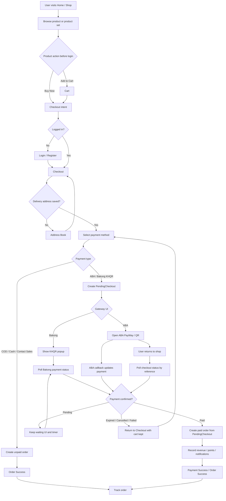

# 💎 UI/UX Design System — Shadow Shop

This document outlines the visual design system, color palette, typography hierarchy, UI components, layout standards, and user experience principles for **Shadow Shop**.

---

## 1. Visual Design Philosophy

Shadow Shop combines **modern enterprise functionality** with a **sleek cosmetics aesthetic**:
- **Clean & High-Contrast:** White and light-slate content areas for effortless data scanning.
- **Deep Navy Command Sidebar:** Authoritative background (`#1e1b4b`) for administrative controls.
- **Vibrant Accents:** Royal Purple (`#7c3aed`) for interactive actions and Hot Pink (`#ec4899`) for cosmetics accents & highlights.
- **Glassmorphism & Soft Shadows:** Subtle translucent overlays and elevation shadows (`shadow-sm`, `shadow-md`) to separate content cards cleanly.

---

## 2. Color Palette & Tokens

### 2.1 Core Palette

```
  Navy Sidebar        Royal Purple        Cosmetic Pink        Success Green       Alert Red
  ┌──────────┐        ┌──────────┐        ┌──────────┐        ┌──────────┐        ┌──────────┐
  │  #1e1b4b │        │  #7c3aed │        │  #ec4899 │        │  #10b981 │        │  #ef4444 │
  └──────────┘        └──────────┘        └──────────┘        └──────────┘        └──────────┘
```

| Token Name | Hex Code | Tailwind Equivalent | Usage |
| :--- | :--- | :--- | :--- |
| **Brand Primary** | `#7c3aed` | `violet-600` | Primary buttons, active tabs, selected states |
| **Brand Secondary**| `#ec4899` | `pink-500` | Cosmetics badges, promotion banners, highlights |
| **Sidebar Background**| `#1e1b4b` | `indigo-950` | Back-office left navigation bar |
| **Background Light**| `#f8fafc` | `slate-50` | Main application background |
| **Surface White** | `#ffffff` | `white` | Cards, modals, data tables |
| **Text Primary** | `#0f172a` | `slate-900` | Main headings, table text |
| **Text Muted** | `#64748b` | `slate-500` | Secondary labels, timestamps |
| **Border Soft** | `#e2e8f0` | `slate-200` | Card borders, table gridlines |

---

## 3. Typography Scale

- **Primary Font Family:** `'Inter', -apple-system, BlinkMacSystemFont, 'Segoe UI', Roboto, sans-serif`
- **Secondary / Khmer Font:** `'Kantumruy Pro', 'Noto Sans Khmer', sans-serif`

```
  Heading 1 (24px / Bold)    ────►  Admin Dashboard Overview
  Heading 2 (20px / SemiBold)──►  Recent Orders & Workflow
  Heading 3 (16px / Medium)  ────►  Product Specifications
  Body Text (14px / Regular) ────►  SKU: SHADOW-LIP-09 (Available Stock: 140)
  Caption (12px / Medium)    ────►  Updated 2 minutes ago
```

---

## 4. Status Badges & Indicators

Order lifecycle status badges provide immediate visual clarity across tables and tracking screens:

```
  [ New ]        ──► Soft Blue Badge (`bg-sky-50 text-sky-700 border-sky-200`)
  [ Printed ]    ──► Purple Badge    (`bg-purple-50 text-purple-700 border-purple-200`)
  [ Preparing ]  ──► Yellow Badge    (`bg-amber-50 text-amber-700 border-amber-200`)
  [ Packed ]     ──► Indigo Badge    (`bg-indigo-50 text-indigo-700 border-indigo-200`)
  [ Shipped ]    ──► Cyan Badge      (`bg-cyan-50 text-cyan-700 border-cyan-200`)
  [ Completed ]  ──► Green Badge     (`bg-emerald-50 text-emerald-700 border-emerald-200`)
  [ Cancelled ]  ──► Red Badge       (`bg-rose-50 text-rose-700 border-rose-200`)
```

---

## 5. Layout Systems

### 5.1 Back-Office Admin Layout
- **Left Navigation Sidebar (Fixed 260px):** Logo header, grouped menu sections (Sales, Catalog, Warehouse, Finance, Team, Settings), collapse toggle, active route indicator.
- **Top Bar Header (Sticky):** Store selector, search input (`Cmd+K`), quick scan button, notification drawer bell, language switcher (EN / KM), user profile avatar dropdown.
- **Main Content Area:** Fluid layout with responsive grid (`grid-cols-1 md:grid-cols-2 lg:grid-cols-4`) for KPI cards.

### 5.2 Customer Portal Layout (Desktop & Mobile Responsive)
- **Desktop Big Screen Layout (`lg:` 1024px+):**
  - **Concept 2 Hero Section (`lg:grid lg:grid-cols-12`):**
    - **Main Hero Slider Track (`lg:col-span-8` / `xl:col-span-9`):** Widescreen promotion banner carousel (`aspect-[21/9]`) with hover overlay chevron controls and active dot indicators.
    - **Desktop Side Quick-Cards (`lg:col-span-4` / `xl:col-span-3`):** Vertical stack of interactive promotion cards:
      - *Card 1 (Flash Sale):* Live deals countdown & quick link to discounted products.
      - *Card 2 (VIP Rewards):* Points exchange & reward voucher claims (`/profile/rewards`).
- **Mobile Responsive Layout (`< lg`):**
  - **Header:** Location address picker, search bar, cart item counter pill.
  - **Hero Carousel:** 90% peek horizontal snap-scroll track with touch gesture support.
  - **Product Grid:** Responsive 2-column mobile grid with 1:1 square product images and touch-friendly action buttons.
  - **Bottom Navigation Bar (Fixed Mobile):** `Home`, `Products`, `Cart`, `My Orders`, `Profile`.

---

## 6. Customer Visit To Payment Success Process

The customer purchase journey must keep the shopper inside a clear guided flow from first page visit until the system confirms payment success.

### 6.1 User Journey

```
Visit Home / Shop
  -> Browse Product / Product Set
  -> Add to Cart / Buy Now
  -> Review Cart
  -> Login / Register if needed
  -> Checkout
  -> Select Delivery Address
  -> Select Payment Method
  -> Confirm Order
  -> Pay / Wait for Payment Confirmation
  -> Payment Success
  -> Order Success / Track Order
```

### 6.2 Flow Chart



### 6.3 Page-Level Flow

| Step | Page / UI | User Action | System Response |
| :--- | :--- | :--- | :--- |
| 1 | `Home` / `Shop` / `Product Detail` | User opens the store and chooses an item. | Load products, promotions, stock-aware pricing, and product-set details. |
| 2 | Product card/detail | User taps `Add to Cart` or `Buy Now`. | Add selected item and quantity to local cart state before login; require login only when checkout/payment starts. |
| 3 | `Cart` | User reviews selected items. | Calculate subtotal, selected product count, quantity, discounts, and delivery readiness. |
| 4 | Login / Register | Guest user continues to checkout. | Authenticate the user, then return to checkout with cart items preserved. |
| 5 | `Checkout` | User confirms customer info and delivery address. | Require a saved address before enabling order submission; calculate delivery fee by province/district. |
| 6 | Payment method selector | User selects `ABA`, `Bakong KHQR`, `COD`, cash, or contact sales. | Show the correct action label: pay now for online methods, place order for offline methods, contact sales for assisted orders. |
| 7A | Online payment: `ABA` / `Bakong KHQR` | User confirms payment. | Backend creates a `PendingCheckout` reference and returns payment data without creating the final order yet. |
| 7B | Offline payment: `COD`, cash, contact sales | User confirms order. | Backend creates an unpaid order immediately and sends the customer to `Order Success`. |
| 8A | `Bakong KHQR` popup | User scans the QR. | Frontend polls payment check every short interval; backend verifies the KHQR transaction and fulfills the pending checkout when paid. |
| 8B | `ABA` PayWay / ABA QR | User pays in ABA flow and returns to the shop. | ABA callback marks payment paid; frontend polls checkout status by pending reference after return. |
| 9 | `Payment Success` / `Order Success` | Payment is confirmed. | Cart selection is cleared, order number is shown, and the user can track the order. |

### 6.4 Online Payment Rules

- Online methods (`aba`, `bakong`) use deferred checkout through `PendingCheckout`.
- The real `Order` is created only after payment is confirmed as paid.
- The final order must be created with `payment_status = paid` and the matching `payment_method`.
- If the user leaves and returns during ABA payment, the browser stores the pending checkout reference and resumes status checking.
- Expired or cancelled payment sessions must not create an order.
- Once paid, the system records revenue, awards customer points, sends payment notifications, and allows normal order tracking.

### 6.5 Success-State UX

- Keep the success screen simple: order number, payment status, paid amount, and tracking action.
- Never show payment success from the frontend alone; success must come from backend status or gateway callback verification.
- If payment is still pending, keep the user on the payment waiting UI with a timer and retry/check state.
- If payment fails, expires, or is cancelled, return the user to checkout with the cart selection still available.

---

## 7. Micro-Interactions & Animations

- **Button States:** Hover light opacity transition (`transition-all duration-200 ease-in-out`), active scale reduction (`active:scale-95`).
- **Modal Dialogs:** Smooth fade-in overlay and slide-up backdrop animation (`animate-in fade-in zoom-in-95`).
- **Scanner Feedback:** High-contrast green flash outline on input when barcode scan succeeds; red pulse on error.

                         ┌─────────────┐
                         │    START    │
                         │ Visit Shop  │
                         └──────┬──────┘
                                ↓
                         ┌─────────────┐
                         │    HOME     │
                         └──────┬──────┘
                                ↓
               ┌───────────────────────────┐
               │      Discover Product     │
               │ Search / Category / Promo │
               └─────────────┬─────────────┘
                             ↓
                     ┌───────────────┐
                     │Product Detail │
                     └───────┬───────┘
                             ↓
                    ┌─────────────────┐
                    │ Choose Quantity │
                    └────────┬────────┘
                             ↓
                     ┌───────────────┐
                     │  User Action? │
                     └───────┬───────┘
                             │
                 ┌───────────┴───────────┐
                 ↓                       ↓
          ┌─────────────┐         ┌─────────────┐
          │ Add to Cart │         │   Buy Now   │
          └──────┬──────┘         └──────┬──────┘
                 ↓                       │
          ┌─────────────┐                │
          │    CART     │                │
          └──────┬──────┘                │
                 └──────────┬────────────┘
                            ↓
                      ┌───────────┐
                      │ CHECKOUT  │
                      └─────┬─────┘
                            ↓
                      ┌───────────┐
                      │ Logged In?│
                      └─────┬─────┘
                            │
                    ┌───────┴────────┐
                  NO↓                ↓YES
             ┌────────────┐          │
             │Login /     │          │
             │Register    │          │
             └─────┬──────┘          │
                   └────────┬────────┘
                            ↓
                    ┌───────────────┐
                    │    Address    │
                    └───────┬───────┘
                            ↓
                   ┌────────────────┐
                   │Address Exists? │
                   └────────┬───────┘
                            │
                     ┌──────┴──────┐
                   NO↓             ↓YES
              ┌─────────────┐      │
              │ Add Address │      │
              └──────┬──────┘      │
                     └──────┬──────┘
                            ↓
                  ┌──────────────────┐
                  │ Delivery Method  │
                  └────────┬─────────┘
                           ↓
                  ┌──────────────────┐
                  │ Payment Method   │
                  └────────┬─────────┘
                           ↓
            ┌──────────────┴──────────────┐
            ↓                             ↓
     ONLINE PAYMENT                OFFLINE PAYMENT
      ABA / Bakong                  COD / Cash
            │                             │
            ↓                             ↓
   ┌─────────────────┐            ┌──────────────┐
   │Pending Checkout │            │ Create Order │
   └────────┬────────┘            │   UNPAID     │
            ↓                     └──────┬───────┘
   ┌─────────────────┐                   │
   │ Payment Gateway │                   │
   └────────┬────────┘                   │
            ↓                            │
     ┌──────────────┐                    │
     │Payment Paid? │                    │
     └──────┬───────┘                    │
            │                            │
      ┌─────┴──────┐                     │
    NO↓            ↓YES                  │
┌───────────┐ ┌──────────────┐           │
│Pending /  │ │ Create Order │           │
│Failed     │ │     PAID     │           │
└─────┬─────┘ └──────┬───────┘           │
      │              │                   │
      │              └─────────┬─────────┘
      │                        ↓
      │                ┌───────────────┐
      │                │ ORDER SUCCESS │
      │                └───────┬───────┘
      │                        ↓
      │                ┌───────────────┐
      │                │  MY ORDERS    │
      │                └───────┬───────┘
      │                        ↓
      │                ┌───────────────┐
      │                │ ORDER DETAIL  │
      │                └───────┬───────┘
      │                        ↓
      │               ┌────────────────┐
      │               │  TRACK ORDER   │
      │               └───────┬────────┘
      │                       ↓
      │        New → Preparing → Packed
      │                       ↓
      │                    Shipped
      │                       ↓
      │                   Completed
      │                       ↓
      │                     END
      │
      └──→ Retry Payment / Change Payment
                         │
                         └──→ Checkout
